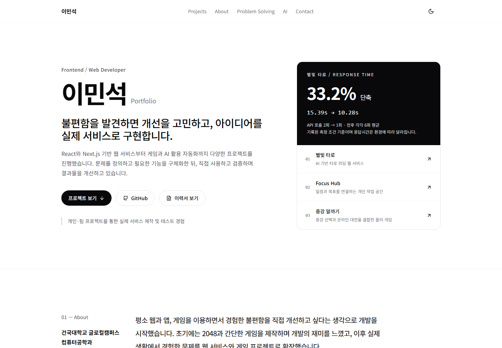
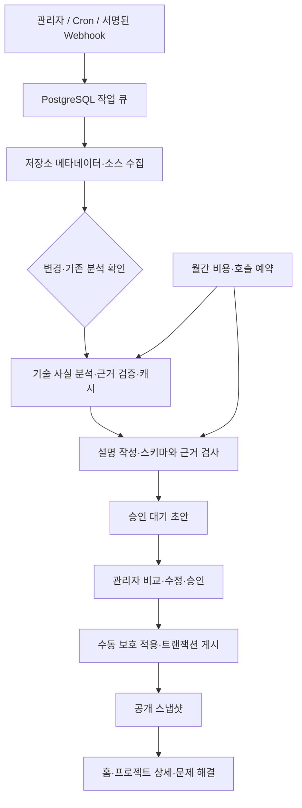

# Portfolio

GitHub 프로젝트의 변경을 코드 근거가 있는 설명 초안으로 만들고, 관리자가 검토한 내용을 공개하는 개발자 포트폴리오입니다.

## 01. Project Overview

프로젝트 소개와 실제 구현 사이의 차이를 줄이기 위해 공개 화면과 수집·분석·검토 작업을 분리했습니다. 방문자는 저장된 공개 스냅샷을 읽고, 관리자는 자동 생성 제안과 직접 작성한 설명을 비교합니다. 기존 데이터와 수동 보호 필드를 유지하는 것이 자동화의 기본 조건입니다.

## 02. Demo & Screenshots

[배포 주소](https://portfolio-iota-sage-3jin175bbg.vercel.app/) · [GitHub](https://github.com/peeta0126/Portfolio)



저장소에 포함된 이전 로컬 프리뷰입니다. 현재 운영 화면과 동일함을 보장하지 않습니다. 방문 흐름은 홈 → 프로젝트 상세 → 전체 문제 해결 기록(`/problem-solving`), 관리 흐름은 `/admin` → 동기화/작업 실행 → 초안 검토·수정 → 승인·공개입니다.

## 03. Key Features

- **공개 콘텐츠:** 프로젝트 목록·상세, 문제 해결 사례, 라이트/다크 모드, 반응형 UI와 이력서 연결. DB 설정 시 승인된 공개 스냅샷만 조회합니다.
- **GitHub 동기화:** 공개 저장소를 페이지 단위로 수집하고 저장소 ID·커밋·소스 manifest로 변경을 확인합니다. 비공개 전환·삭제·이전된 저장소는 숨깁니다.
- **2단계 AI 분석:** 선별 소스의 기술 사실과 발췌를 검증한 뒤 설명을 작성합니다. 저장된 기술 분석으로 설명만 재작성할 수 있으며 신규 설명은 항상 승인 대기입니다.
- **작업 큐:** PostgreSQL 큐의 중복 키·lease·최대 3회 시도와 지연 재시도로 수집/분석/재작성을 처리합니다. HTTP 요청 한 번에 작업 하나를 실행합니다.
- **관리자 검토:** 본문·초안·근거 비교, 편집·승인·거절, 공개 상태·순서 변경과 이미지 업로드. 수동 보호 필드와 편집 충돌 검사를 적용합니다.
- **비용 제한:** 외부 요청 전에 월간 예산과 호출 횟수를 예약합니다. 응답 유실 시 예약액을 유지하며 추정 비용과 사용량을 기록합니다.

## 04. Tech Stack

`package-lock.json` 기준: Next.js **15.5.28**, React **19.2.7**, TypeScript **5.9.3**, Tailwind CSS **3.4.19**, Zod **4.6.7**, postgres **4.1.0**. Framer Motion·Lucide React를 UI에 사용합니다.

서버는 App Router Route Handler, DB는 PostgreSQL·JSONB, 관리자 인증은 scrypt와 서명된 HttpOnly 쿠키입니다. GitHub REST/Webhook과 서버의 OpenAI Responses API를 연결하며 Node test·PGlite·Playwright로 검사합니다. Vercel Cron과 선택적 GitHub Actions 실행기 설정이 포함됩니다.

## 05. Architecture



DB 미설정 시 `data/projects.ts`의 정적 프리뷰를 사용합니다. 기존 3개 원문은 `data/project-archive.ts`와 `backups/`에 보존합니다. DB 장애 시 숨긴 프로젝트가 원문으로 복원되지 않도록 목록을 비웁니다. [운영·DB·인증 상세](docs/automation.md)

## 06. Technical Challenges & Solutions

- **분석 표본 편향 → Scene 편중 선별 → 종류별 할당과 핵심 모듈 우선순위 → `tests/editorial.test.ts`의 게임/네트워크 선별 회귀 검사.** [조사 기록](docs/editorial-upgrade.md)
- **유효한 설명까지 근거 오류로 폐기 → 참조 표기 차이와 불완전한 항목의 일괄 처리 → 제공된 파일의 줄 범위 정규화·항목별 제외 → `tests/core.test.ts`의 범위 거부·기본 설명 보존 검사.** [수정 기록](docs/invalid-evidence-fix.md)
- **자동 병합 중 원문 손실 위험 → AI 제안과 직접 편집의 충돌 → 필드별 보호·원본 백업·트랜잭션 → 원문 바이트 일치·보호 필드 검사.**

개발 경위는 연결된 기록을 따르며 위 검사는 성능 개선 수치의 근거가 아닙니다.

## 07. My Contributions

프로필은 AI 도구로 구현을 구체화하고 코드·화면 검토와 테스트를 반복하는 작업 방식을 명시합니다. 위 기능은 저장소 전체 구현 범위입니다. 개인의 직접 구현 범위와 팀 역할은 Git 작성자만으로 확정하지 않으며 담당 역할·기획 배경·회고는 본인 확인이 필요합니다.

## 08. Getting Started

Node.js 22 이상과 npm을 권장합니다. 일반 화면 확인은 DB 없이 가능합니다.

```sh
npm ci
npm run dev
```

자동화·관리자는 [.env.example](.env.example)을 `.env.local`로 복사하고 서버 전용 변수를 설정합니다. `DATABASE_URL`, `APP_URL`, 관리자 해시·세션 비밀값이 기본 설정이며 AI 분석에는 모델·키·입출력 단가가 추가로 필요합니다. 값은 커밋하지 않습니다.

전용 PostgreSQL에만 아래 이관 명령을 실행합니다. seed는 기존 원문 3개를 보존하며 정적 프리뷰의 모든 추가 원고를 게시하는 명령은 아닙니다.

```sh
npm run db:migrate
npm run db:seed
npm run admin:password
npm test
npm run test:integration
npm run lint
npm run typecheck
npm run build
npm start
```

브라우저 검사는 `npm run build:verify` → `npx playwright install chromium` → `npm run test:e2e` 순서입니다. `.next-verify`와 격리된 메모리 DB를 사용합니다. 운영 DB 이관·배포는 빌드에 포함되지 않습니다. 일일 Cron만으로 큐 전체를 처리할 수 없으므로 [선택 실행기 설정](docs/automation.md)을 확인하세요.

## 09. Project Structure

```text
app/                   공개 페이지·관리자·API
components/, sections/ 공통 UI·홈 섹션
data/                  정적 프리뷰·보존 원문·프로필
lib/automation/        수집·분석·근거·비용·큐·인증·게시
db/                    추가형 SQL 마이그레이션
scripts/               이관·격리 검증·운영 확인 도구
tests/                 단위·Mock 통합·브라우저 검사
docs/                  운영 지침·변경 및 검증 이력
```

## 10. Current Status & Limitations

2026-11-21 문서 정비에서 `npm test` **29개 통과**를 확인했습니다. 통합·브라우저·빌드와 실제 API 호출은 이번에 재실행하지 않았습니다. [2026-11-18 검증 기록](docs/portfolio-second-pass-results.md)과 [이전 운영 반영 기록](docs/editorial-deployment.md)은 당시 결과이며 최신 배포 상태의 보증이 아닙니다.

분석은 최대 18개 파일의 제한된 표본이며 문장의 의미와 개인 기여를 자동 증명하지 않습니다. 다중 관리자·2FA·GitHub App 설치 UI·자동 스크린샷·대형 저장소 다단계 분석은 미구현입니다. 운영 DB·외부 API·스케줄러 설정은 별도 확인해야 합니다. 문서의 `artifacts/` 경로는 Git에서 제외된 로컬 검증 자료이며 GitHub 첨부파일이 아닙니다.
