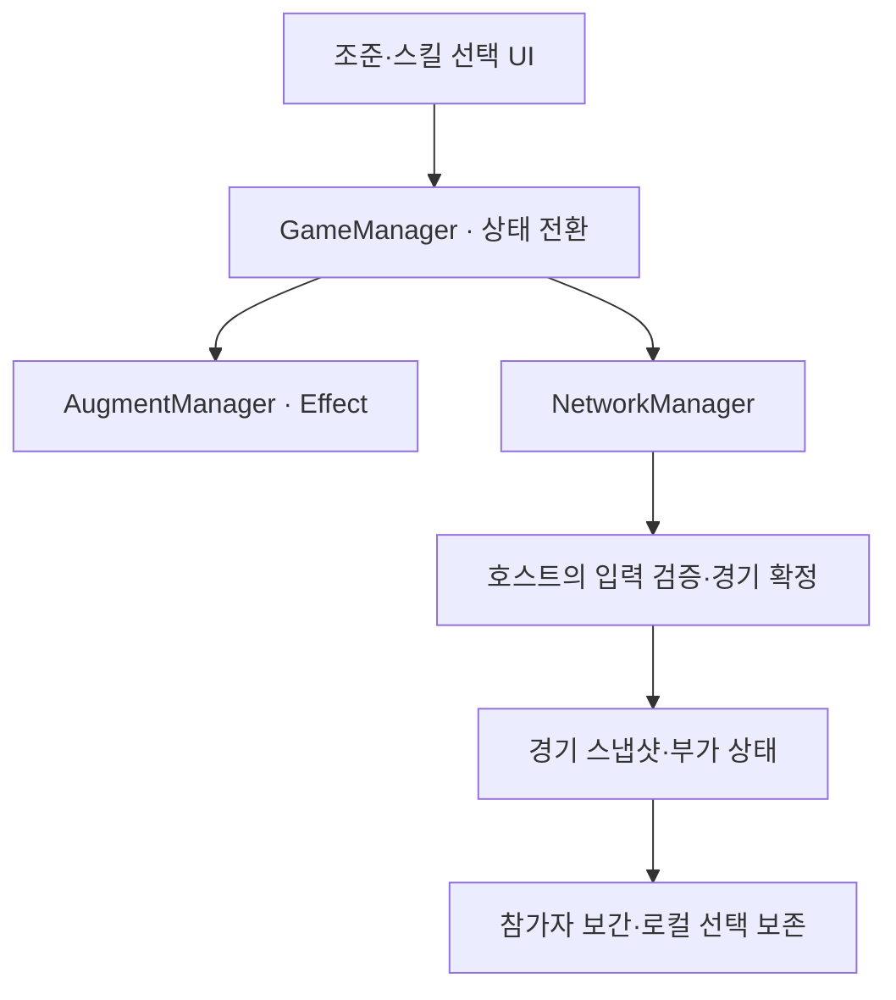

# 증강 알까기 상세 설명 초안

로컬 검토용이며 운영 DB·공개 페이지에는 반영하지 않았습니다. 개인 동기·기간·프로젝트 유형·회고는 관리자 확인이 필요합니다.

## 프로젝트 헤더

**증강 알까기** — 증강 선택과 호스트 권위 동기화를 결합한 물리 기반 대전 게임

돌을 밀어 상대 돌을 보드 밖으로 보내는 물리 알까기에 증강 선택을 연결한 대전 게임입니다. 같은 조작 규칙 안에서 돌의 특성·발사 방식·필드 조건을 바꾸며 서로 다른 전략을 구성할 수 있고, 로컬 대전과 온라인 대전에 같은 경기 규칙을 적용합니다.

개발 기간: 기간 확인 필요 / 구분: Project (기존 값을 보존했으며 새로 확정한 정보가 아닙니다.)

기술: Godot, GDScript, GD-Sync, RigidBody2D

GitHub: https://github.com/peeta0126/AugmentAlkkagi

배포/실행 링크: 공개 배포본 미확인. Windows 내보내기 프리셋은 있으나 배포 완료로 표현하지 않습니다.

## 프로젝트 소개

증강 알까기는 한 번의 발사 결과를 읽는 물리 조작과, 라운드마다 달라지는 선택을 함께 다루는 게임입니다. 증강은 단순한 수치 보너스에 머물지 않고 돌의 변신, 발사 변환, 시야 제한, 임시 벽과 특수 승리 조건으로 플레이 방식을 바꿉니다. 온라인에서도 참가자가 각자 결과를 계산하는 대신 호스트가 경기 결과를 확정하고, 참가자는 조작을 요청하고 확정된 상태를 받아 표시하는 구조를 사용합니다.

## 기획 배경 및 목표

관리자 확인 대기: 개인적 개발 동기와 시작 배경은 자료만으로 확정하지 않았습니다. 구현에서 확인되는 사용자 경험은 물리 조작과 증강 선택을 한 경기 흐름에 연결한 것입니다.

## 담당 역할

Git 기록에서 peeta0126 계정의 온라인 스킬 처리, 발사력 표시 초기화와 UI 상태 수정, 동결 차례 넘기기 및 관련 테스트 추가를 확인했습니다. 팀 전체의 증강 기획·리소스 제작·모든 기능을 개인 담당 범위로 확장하지 않았습니다.

## 핵심 기능

- 물리 기반 턴제 대전 — 조준과 발사 뒤 모든 돌의 이동과 탈락 판정을 해소한 다음 차례를 넘겨, 입력과 결과 판정의 경계를 분명하게 나눕니다.

- 라운드 기반 증강 선택 — 시작 전과 공동 라운드의 선택 단계를 구분하고, 양쪽 선택이 끝나기 전에는 다음 행동으로 넘어가지 않도록 경기 흐름에 연결합니다.

- 서로 조합되는 증강 — 돌의 물리 특성, 발사 방식, 충돌 반응과 필드를 개별 효과로 나누고, 처리 순서를 정해 획득 순서가 조합 결과를 바꾸지 않도록 구성했습니다.

- 로컬·온라인 대전 — 로컬에서는 한 화면에서 번갈아 조작하고, 온라인에서는 GD-Sync 방과 준비 과정을 거쳐 호스트 검증 아래 같은 경기 규칙을 적용합니다.

- 경기 상태와 조작 UI의 분리 — 참가자의 대상 선택, 발사력 표시, 동결 차례 넘기기를 경기 상태와 연결하되 늦게 도착한 동기화가 진행 중인 입력을 무조건 덮지 않게 처리합니다.

## 기술 구조

GameManager가 경기 진행과 상태 전환을 조율하고, AugmentManager는 정의 Resource와 개별 Effect를 연결해 소유·사용·발동을 관리합니다. 돌의 이동과 충돌은 물리 오브젝트가 맡고 UI는 선택과 조작을 전달합니다. 온라인 경계에서는 NetworkManager가 참가자 입력을 검증할 호스트로 전달하며, 경기 결과와 부가 상태를 스냅샷으로 돌려보냅니다. 참가자는 확정 상태를 보간해 표시하면서 아직 확정되지 않은 로컬 대상 선택은 별도로 유지합니다.

## 핵심 구현 과정

- 증강 정의와 실행 효과를 분리하고 발사 전·충돌·이동 정지·턴 종료 같은 공통 시점에 개별 Effect를 호출합니다. 이 구조에서는 경기 전체 흐름과 증강별 동작을 구분해 다루며 여러 증강이 같은 처리 시점에 참여할 수 있습니다.

- 물리 해소와 라운드 보상을 분리했습니다. 양쪽이 정상 행동을 마쳤는지 확인하고, 승패가 결정된 뒤에는 다음 증강 선택을 열지 않도록 턴 완료 경계를 관리합니다.

- 온라인 참가자의 입력을 결과 변경과 구분했습니다. 스킬 대상과 요청 순서는 호스트에서 검증하고, 승인·거절 응답과 확정 스냅샷을 받은 뒤 참가자 상태를 정리합니다.

- 매번 전체 상태를 보내는 대신 이동 중심 상태와 증강·벽 같은 부가 상태를 나눴습니다. 변화가 없을 때 전송을 쉬되 heartbeat와 종료 시 캐시 초기화로 유휴·재접속 경로도 다룹니다.

- 지연이나 취소가 UI를 오래된 상태로 되돌리는 경로를 회귀 테스트로 분리했습니다. 대상 선택 보존, 파워 초기화, 동결 차례 넘기기를 각각 재현하는 테스트를 두어 경기 규칙과 화면 상태를 함께 확인할 수 있게 했습니다.

## 문제 해결 과정

### 호스트 스냅샷과 참가자 타깃 선택의 상태 충돌 분리

**Problem** — 참가자가 스킬 대상을 고르는 동안 호스트는 아직 조준 상태에 있습니다. 이 값을 참가자 화면에 그대로 적용하면 진행 중인 대상 선택이 취소될 수 있는 상태 충돌이 있었습니다.

**Approach** — 참가자의 로컬 타깃 선택과 호스트가 확정하는 경기 상태를 구분했습니다. 자기 차례의 대상 선택 중에는 호스트의 조준 상태로 되돌리지 않고, 요청 순서와 승인 결과를 확인한 뒤 효과와 턴을 반영하도록 변경했습니다.

**Result** — 선택 상태 보존 분기와 호스트 스냅샷을 주입하는 회귀 테스트를 추가했습니다. 동기화로 갱신할 경기 상태와 참가자에게 유지할 입력 상태를 구분하는 구조가 코드에 반영되어 있습니다.

### 발사력 표시와 실제 입력 상태의 생명주기 맞추기

**Problem** — 발사력 표시의 초기값과 조준 취소·발사 후 상태가 따로 관리되면, 실제 입력이 끝났어도 이전 드래그 값이 화면에 남을 수 있었습니다.

**Approach** — HUD 초기값을 정리하고 발사·취소·HUD 재생성·참가자 스냅샷 경로에서 같은 초기 상태로 돌아가도록 수정했습니다. 일반 발사뿐 아니라 증강 발사와 재시작 경로까지 검사 대상으로 넓혔습니다.

**Result** — 게이지 값·표시 문자열·채움 패널을 함께 검사하는 회귀 테스트를 추가했습니다. 발사 종료뿐 아니라 취소·스냅샷 적용·재시작을 포함해 화면 표시와 입력 상태가 어긋날 수 있는 경로를 구체적으로 점검하도록 구성했습니다.

### 동결 상태의 턴 진행과 늦게 도착한 요청 구분

**Problem** — 자기 돌이 모두 동결되면 발사할 수 없으므로 턴을 끝내는 별도 경로가 필요합니다. 온라인에서는 중복 요청이나 이전 턴의 응답이 다음 차례를 바꾸지 않도록 처리해야 했습니다.

**Approach** — 발사 불가 사유와 현재 차례를 확인한 경우에만 넘기기를 허용하고, 호스트가 턴 revision과 요청 순서를 검증하도록 연결했습니다. 참가자는 요청이 진행 중일 때 추가 입력을 막고 과거 revision의 스냅샷은 적용하지 않습니다.

**Result** — 동결 해제 시점, 중복·과거 요청 거절, 지연 응답, 타임아웃 후 재시도를 검사하는 회귀 테스트를 추가했습니다. 턴을 넘기는 정상 경로와 이전 차례의 요청을 거부하는 경로를 함께 점검하도록 구성했습니다.

## 개발 결과

로컬 대전의 물리 규칙과 증강 선택을 온라인 호스트 검증 구조에 연결했습니다. 개별 효과를 추가하는 구조뿐 아니라 조합·턴 완료·참가자 입력·취소를 다루는 회귀 테스트 코드도 갖췄습니다. 다만 최신 버전의 실제 서비스 검증, 서로 다른 기기의 플레이 세션, 밸런스와 배포 방식은 확인하거나 보완할 과제로 남아 있습니다.

## 남은 과제

- 최신 네트워크 코드와 과거 검증 문서의 버전 차이를 확인하고 별도 기기 환경에서 통합 검증이 필요합니다.
- 실제 플레이를 통한 증강 밸런스 점검과 배포 방식 확정이 남아 있습니다.

## 회고 확인용 초안 — 공개 자동 반영 제외

확인용 회고 제안: 참가자만 알고 있는 입력 상태와 호스트가 확정하는 경기 상태를 나누면서 어떤 판단 기준을 얻었는지, 턴 완료 경계와 회귀 테스트를 다음 프로젝트에 어떻게 적용하고 싶은지 본인의 경험으로 확인해 주세요.

## 이미지 준비 상태

실제 게임 스크린샷은 업로드 대기입니다. 저장소의 lobby_logo.png는 로고 후보로만 분류했으며 게임 화면으로 사용하지 않습니다.

---

## 관리자용 근거 — 공개 본문과 분리

검토 기준 커밋: 0b2f7cba2c8b3d9ff1418e2f8325ffef2a09963f

| 사실 | 구분 | 근거 |
| --- | --- | --- |
| 물리 알까기에 로컬·온라인 대전과 증강 선택을 연결한 게임 | implementation | [README.md](https://github.com/peeta0126/AugmentAlkkagi/blob/0b2f7cba2c8b3d9ff1418e2f8325ffef2a09963f/README.md) |
| 증강 정의 Resource와 동작 Effect를 분리하고 플레이어별 사용·쿨다운을 관리한다 | architecture | [docs/AUGMENT_DESIGN.md](https://github.com/peeta0126/AugmentAlkkagi/blob/0b2f7cba2c8b3d9ff1418e2f8325ffef2a09963f/docs/AUGMENT_DESIGN.md) |
| 공동 라운드 완료와 양쪽 선택 완료를 구분해 다음 행동으로 넘어간다 | implementation | [docs/GAME_DESIGN.md](https://github.com/peeta0126/AugmentAlkkagi/blob/0b2f7cba2c8b3d9ff1418e2f8325ffef2a09963f/docs/GAME_DESIGN.md) |
| 호스트가 규칙·난수·물리·승패를 확정하고 참가자는 입력을 요청한다 | architecture | [docs/NETWORK_ARCHITECTURE.md](https://github.com/peeta0126/AugmentAlkkagi/blob/0b2f7cba2c8b3d9ff1418e2f8325ffef2a09963f/docs/NETWORK_ARCHITECTURE.md) |
| 변화 기반 빠른 상태와 신뢰성 있는 부가 상태를 분리한다 | architecture | [docs/NETWORK_ARCHITECTURE.md](https://github.com/peeta0126/AugmentAlkkagi/blob/0b2f7cba2c8b3d9ff1418e2f8325ffef2a09963f/docs/NETWORK_ARCHITECTURE.md) |
| 증강 조합 결과가 획득 순서에 종속되지 않도록 효과 순서를 명세했다 | implementation | [docs/AUGMENT_DESIGN.md](https://github.com/peeta0126/AugmentAlkkagi/blob/0b2f7cba2c8b3d9ff1418e2f8325ffef2a09963f/docs/AUGMENT_DESIGN.md) |
| 증강의 발사 전·충돌·정지·턴 종료 후크를 관리한다 | implementation | [scripts/augments/augment_manager.gd](https://github.com/peeta0126/AugmentAlkkagi/blob/0b2f7cba2c8b3d9ff1418e2f8325ffef2a09963f/scripts/augments/augment_manager.gd) |
| 참가자의 로컬 타깃 선택 중 호스트의 조준 상태가 도착해도 선택을 유지한다 | implementation | [scripts/core/game_manager.gd](https://github.com/peeta0126/AugmentAlkkagi/blob/0b2f7cba2c8b3d9ff1418e2f8325ffef2a09963f/scripts/core/game_manager.gd) |
| 호스트 스냅샷을 적용해도 스킬 대상 선택이 유지되는지 검사하는 테스트가 있다 | test | [tests/test_client_active_skill.gd](https://github.com/peeta0126/AugmentAlkkagi/blob/0b2f7cba2c8b3d9ff1418e2f8325ffef2a09963f/tests/test_client_active_skill.gd) |
| 발사·취소·재시작·참가자 스냅샷 뒤 파워 표시 초기화 회귀 테스트가 있다 | test | [tests/test_shot_power_reset.gd](https://github.com/peeta0126/AugmentAlkkagi/blob/0b2f7cba2c8b3d9ff1418e2f8325ffef2a09963f/tests/test_shot_power_reset.gd) |
| 동결로 발사 불가한 차례에는 턴 revision을 검증해 넘기고 오래된 스냅샷을 무시한다 | implementation | [scripts/core/game_manager.gd](https://github.com/peeta0126/AugmentAlkkagi/blob/0b2f7cba2c8b3d9ff1418e2f8325ffef2a09963f/scripts/core/game_manager.gd) |
| 중복·과거 턴·지연 응답·미인증 참가자의 넘기기 요청을 검사하는 회귀 테스트가 있다 | test | [tests/test_stasis_pass_turn.gd](https://github.com/peeta0126/AugmentAlkkagi/blob/0b2f7cba2c8b3d9ff1418e2f8325ffef2a09963f/tests/test_stasis_pass_turn.gd) |
| 과거 프로토콜 검증 보고서는 같은 PC의 두 프로세스로 확인했으며 분리된 두 PC의 재검증은 남았다 | result | [docs/TEST_REPORT.md](https://github.com/peeta0126/AugmentAlkkagi/blob/0b2f7cba2c8b3d9ff1418e2f8325ffef2a09963f/docs/TEST_REPORT.md) |
| 실제 플레이 밸런스 점검과 배포 방식 결정은 로드맵의 남은 과제다 | result | [docs/ROADMAP.md](https://github.com/peeta0126/AugmentAlkkagi/blob/0b2f7cba2c8b3d9ff1418e2f8325ffef2a09963f/docs/ROADMAP.md) |
| UI·온라인 스킬·발사력 초기화를 함께 수정한 실제 변경이 있다 | history | [커밋 989b60c0](https://github.com/peeta0126/AugmentAlkkagi/commit/989b60c08816f7dacaa370e9e651aa43bf6684d5) |
| 참가자의 스킬 대상 선택과 스냅샷 상태 충돌을 수정하고 회귀 테스트를 추가했다 | history | [커밋 ed2086c4](https://github.com/peeta0126/AugmentAlkkagi/commit/ed2086c42a8977a2fb554fe0c70168838dcb41a2) |
| 동결 차례 넘기기와 턴 revision 검증을 추가한 실제 변경이 있다 | history | [커밋 0b2f7cba](https://github.com/peeta0126/AugmentAlkkagi/commit/0b2f7cba2c8b3d9ff1418e2f8325ffef2a09963f) |
| peeta0126 계정의 세 커밋에서 온라인 스킬·UI 상태·턴 넘기기 변경을 확인했다 | contribution | [커밋 989b60c0](https://github.com/peeta0126/AugmentAlkkagi/commit/989b60c08816f7dacaa370e9e651aa43bf6684d5), [커밋 989b60c0](https://github.com/peeta0126/AugmentAlkkagi/commit/989b60c08816f7dacaa370e9e651aa43bf6684d5), [커밋 0b2f7cba](https://github.com/peeta0126/AugmentAlkkagi/commit/0b2f7cba2c8b3d9ff1418e2f8325ffef2a09963f), [커밋 ed2086c4](https://github.com/peeta0126/AugmentAlkkagi/commit/ed2086c42a8977a2fb554fe0c70168838dcb41a2) |

## 추가 확인 사항

- 개발 시작·종료일과 개인/팀 프로젝트 표기는 관리자 확인 필요. Git 활동 시점을 개발 기간으로 대신하지 않음.
- 여러 기여자와 팀 문서는 확인되지만 전체 기능의 개인 기여도와 팀 내 역할은 별도 확인 필요.
- 개인 개발 동기와 회고는 확인되지 않음.
- 문서의 네트워크 설명은 v4, 최신 코드 PROTOCOL_VERSION은 6. 최신 버전의 실서비스 통합 검증은 확인되지 않음.
- 이번 조사에서는 Godot 테스트를 실행하지 않았음. 테스트 코드의 단언과 과거 보고서만 확인함.
- 실제 게임 스크린샷은 확인되지 않아 업로드 대기. 저장소 로고·아이콘을 플레이 화면으로 취급하지 않음.

기존 수동 보호 필드를 적용한 실제 승인 미리보기는 JSON의 approvalPreview에 있습니다. 전체 수정안 proposal과 구분해서 검토해야 합니다. 기존 잠금 필드는 자동 승인으로 교체되지 않습니다.
