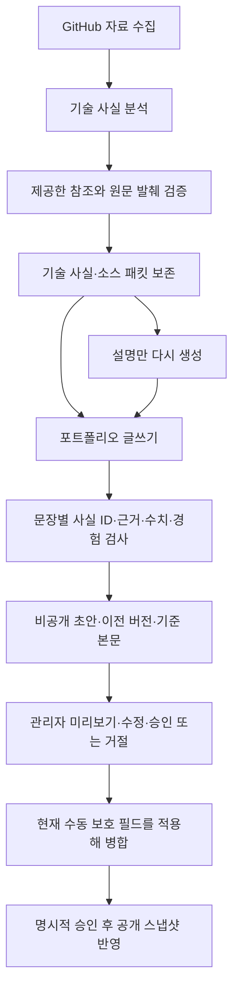

# GitHub 프로젝트 상세 설명 개선 보고서

2026-11-07. 작업 범위는 조사, 로컬 원고·코드 수정과 Mock 검증이다. 운영 DB 쓰기·마이그레이션·OpenAI 호출·Git commit/push·Vercel 배포는 실행하지 않았다.

## 1. 기존 설명의 문제와 조사 범위

운영 DB는 읽기 전용 트랜잭션으로 조사했다. 프로젝트 6개, 기존 AI 분석 3개, 홈 Problem Solving 4개가 있었다. 저장소 URL은 DB의 repository/html_url 및 content.github에서 확인했다.

| 프로젝트 | 실제 저장소 | 조사 결과 |
| --- | --- | --- |
| 증강 알까기 | peeta0126/AugmentAlkkagi | 공개. 최신 커밋 고정, 전체 tree, README·설계/네트워크/테스트 문서, 핵심 게임·증강·물리·UI·네트워크 코드, 회귀 테스트, 최근 30개 및 게임 매니저 경로별 커밋 이력, 세 실제 diff, PR/Issue 조사 |
| Voyager Atelier | peeta0126/monster-rpg | 공개. tree·README·플레이어 스프라이트·폰트 스크립트·커밋/PR 조사. 폰트 측정은 과거 perf 커밋에서 별도로 확인 |
| 별빛 타로 | peeta0126/tarot-card | 비공개이나 연결된 GitHub 권한으로 읽기 가능. tree·API·스키마·입력 격리 테스트·커밋/PR 조사. 코드/비밀값을 공개 원고에 복사하지 않음 |
| CrewSpace | peeta0126/CrewSpace | 공개. 전체 tree·App·상태 조율 훅·인증 UI 훅·설정/커밋 조사. README는 Vite 템플릿이므로 기능 근거에서 제외 |
| Developer Portfolio | peeta0126/Portfolio | 공개. 원격 코드와 로컬 자동화/관리자/DB/이미지/테스트 구조를 조사 |
| Focus Hub | peeta0126/Focus-Hub | 공개. tree·README·대시보드·AppShell·TaskManager·인증·DB/RLS·서비스 워커·테스트/커밋/PR 조사 |

포트폴리오 메인과 기존 3개 상세 페이지는 HTTP 200이었다. DB에 public인 신규 3개 프로젝트의 현재 URL은 모두 HTTP 404였다. 이는 배포 화면과 현재 연결 DB 상태가 일치하지 않는 관찰이며, 원인이 코드 버전·환경변수·별도 DB 중 무엇인지는 확인하지 않았다. 외부 설정을 변경하지 않았다. 확인한 HTML은 `artifacts/research/site/`에 보관했다.

증강 알까기 기존 분석의 실제 본문 입력 18개 중 15개가 이펙트 `.tscn`이었다. `.gd` 입력은 0개이고 테스트 본문도 없었다. tree의 경로 존재와 실제 코드 분석을 혼동하지 않아야 한다. 이 표본으로는 증강·네트워크·턴 진행의 구현 이유나 수정 사례를 설명하기 어렵다.

생성 스키마도 overview/features/implementation/architecture 위주여서 기존 상세 UI가 지원하는 배경·목표·역할·결과·회고·구조 레이어를 충분히 채우지 못했다. 본문에 출처를 쓰지 말라는 계약과 문장별 사실 연결이 없었으며, 실제 diff와 테스트보다 커밋 제목에 의존했다.

## 2. 새 분석·글쓰기 흐름

### 기술 사실

facts를 implementation / architecture / intent / contribution / test / result / history로 분류하고, 각 사실에 정확한 source ID와 실제 전달 원문에 포함된 quote를 요구한다. 개인 동기·기여·과거 사건을 코드 패턴으로 확정하지 않는다. 중복 fact ID, 없는 참조, 존재하지 않는 발췌, 근거에 없는 측정 수치와 실행 결과를 거부한다.

기술 결과는 프로젝트·커밋·실제 근거 내용 해시·파이프라인 버전으로 재사용한다. 같은 파일의 선별 순서가 달라져도 같은 사실을 다시 유료 분석하지 않도록 순서를 정규화해 해시한다. 이전 AI 분석이 있으면 참고 문맥으로 전달하되 현재 원문에서 확인되지 않은 주장을 사실로 승격하지 않는다.

### 상세 글쓰기

기존 Generated와 호환되는 portfolio 필드에 배경·목표·담당 역할·핵심 구조·결과·남은 과제·확인용 회고를 작성한다. 공개 문자열은 fieldEvidence로 fact ID에 연결한다. 본문의 `[근거: ...]` 같은 표식을 거부하고 근거는 별도 구조로만 받는다.

기술 선택의 이유는 intent, 개인 역할은 contribution 근거가 있어야 작성한다. 미확인 항목은 빈 문자열/배열과 관리자 메모로 남긴다. Problem Solving은 실제 참조·변경 이력과 검증 근거가 있는 항목만 남기고 부족한 항목만 제외한다. 제외 후에는 항목 인덱스별 fieldEvidence도 함께 이동시킨다. 검증 가능한 기본 설명은 유지한다.

retrospectiveDraft는 관리자용이다. 공개 Project의 retrospective에는 자동 병합하지 않으며, 본인이 확인한 문장은 초안 편집에서 명시적으로 저장해야 한다. 기간·Personal/Team·기존 이미지·기여 범위는 임의 추정하지 않는다.

기계 검사는 **참조/발췌의 실재와 구조, 일부 근거 없는 표현**을 검사한다. 인용문이 작성 문장의 의미·인과관계를 실제로 뒷받침하는지까지 자동 증명하지는 않는다. 새 편집 파이프라인은 기존 autoPublish 설정과 관계없이 항상 승인 대기로 저장한다.

두 단계 모두 기존 월간 예산·호출 횟수 제한과 비용 예약을 적용한다. 기술 단계의 출력 상한은 5,500토큰, 상세 글쓰기는 9,000토큰이며 비용 예약도 각 상한에 맞춘다. 외부 요청을 같은 실행에서 즉시 반복하지 않는다. 글쓰기 실패 시에도 기술 결과를 보존해 재시도 시 재사용한다. 이번에는 두 단계 모두 Mock으로만 호출했다.

Strict JSON Schema는 모든 객체 속성을 required로 두고 additionalProperties=false로 제한했다. 미확인 자연어는 빈 값으로 표현한다. [OpenAI Structured Outputs 공식 문서](https://developers.openai.com/api/docs/guides/structured-outputs)의 계약을 확인하고 중첩 스키마까지 자동 검사했다. 모델 이름과 단가는 기존 환경변수를 사용한다.

### 수집 범위 개선

문서·코드·테스트·설정·Scene의 선별 비중을 나누고 핵심 게임/네트워크 모듈의 우선순위를 높였다. 큰 중앙 모듈을 크기만으로 완전히 배제하지 않으며, 최근 커밋 3개의 실제 diff와 작성자·날짜, Issue 자료도 제한된 범위에서 수집한다. 참고 이미지에 저장소 로고도 포함하되 자동으로 스크린샷으로 채택하지 않는다.

수집은 여전히 제한된 표본이다. 기본 파일 18개, 파일당 본문 10,000자, 전체 65,000자와 요청 UTF-8 상한을 사용하며 diff도 제한한다. 매우 큰 파일의 후반부까지 완전히 분석했다고 표현하지 않는다. 문서와 코드 충돌은 미확인 정보로 남긴다.

## 3. 변경 파일

| 영역 | 파일 | 변경 |
| --- | --- | --- |
| 응답·검증 | lib/automation/schema.ts, editorial.ts, evidence.ts, prose.ts | 추가 서술 필드, 사실/발췌·문장별 연결·인라인 표식 검사, 항목별 Problem Solving 처리 |
| AI 단계 | lib/automation/ai.ts, model.ts | 기술 분석 캐시와 상세 글쓰기 분리, 단계별 비용 예약·상한 |
| 수집·보호 | lib/automation/github.ts, core.ts, content.ts | 소스 구성 개선, diff/Issue 수집, 수동 보호 병합, 객체 키 순서만 달라졌을 때 잘못 잠그지 않도록 개선 |
| 초안·작업 | lib/automation/drafts.ts, worker.ts, db.ts, queue.ts | 버전·수정·승인·거절·재작성 큐, 승인 전 게시 차단, rewrite 초기화 범위 |
| 관리자 | app/api/admin/route.ts, app/admin/dashboard.tsx, content-draft-card.tsx, project-preview.tsx | 인증·Origin 검증, 자연어 미리보기, 항목별 수정, 근거/미확인/회고 제안, 이전 버전 비교 |
| 공개 상세 | types/index.ts, app/projects/[slug]/page.tsx | 기존 구조를 재사용하고 남은 과제 표시 지원 |
| 마이그레이션 | db/002_editorial.sql, scripts/migrate.ts | 새 테이블 두 개의 추가형 변경만 준비 |
| 조사·로컬 초안 | scripts/inspect-portfolio.ts, inspect-site.mjs, prepare-augment-draft.ts | 읽기 전용 조사, 저장소 조사 자료를 사용하는 로컬 검증·초안 생성 |
| 검증 | tests/editorial.test.ts, core.test.ts, fixtures/editorial.ts, integration/automation.test.ts, e2e/admin.spec.ts, scripts/test-server.ts | 사실·보존·비용/캐시·승인·반응형 테스트 |
| 문서·격리 | docs/drafts/*, docs/editorial-upgrade.md, docs/automation.md, tsconfig.json | 원고/조사 기록과 외부 조사용 소스를 컴파일 대상에서 분리 |

## 4. 추가 필드와 데이터 보존

기존 테이블과 원본 데이터는 바꾸지 않는 추가형 SQL이다.

| 위치 | 필드 |
| --- | --- |
| Generated.portfolio | background, goal, roleSummary, responsibilities, architectureLayers, userFlow, result, limitations, retrospectiveDraft |
| Generated.fieldEvidence | field, factIds |
| Project.detail | limitations만 선택 필드로 추가. 기존 배경·목표·역할·구조·결과·회고·이미지 필드는 재사용 |
| portfolio_technical_analysis | project_id, commit_sha, source_hash, pipeline_version, facts, source_packet, token_usage, estimated_cost, created_at |
| portfolio_content_drafts | project_id, technical_id, parent_id, commit_sha, analyzed_files, analysis_result, generated_content, base_content, status, token_usage, estimated_cost, edited_fields, revision, created_at, updated_at |

두 새 테이블 모두 RLS를 활성화하고 브라우저용 공개 정책은 만들지 않는다. 기존 project_analysis와 사용량·로그·프로젝트·홈 항목을 삭제하거나 이관해 덮지 않는다. 새 초안은 공개 조회 함수에서 읽지 않는다.

승인은 트랜잭션에서 현재 프로젝트와 초안을 잠그고 revision을 비교한 뒤 최신 수동 보호 필드를 적용한다. 초안에서 직접 수정한 항목도 이후 보호 필드로 남긴다. 공개 상태 유지와 승인 후 게시를 구분한다. 기존 회고·이미지·기간·유형은 별도 제안으로 자동 교체하지 않는다.

기존 `[근거: ...]`의 정리는 즉시 UPDATE가 아니라 original/base_content, 정리한 generated_content, 분리된 citations를 가진 초안으로 만든다. 제거한 참조를 자동 검증된 사실로 취급하지 않는다. 승인 전 공개 내용은 그대로이며, 기준 본문이 달라졌으면 충돌로 거부한다.

새 테이블이 아직 없으면 관리자 GET은 기존 프로젝트/분석을 계속 제공하고 신규 목록만 비운다. 새 편집 명령은 마이그레이션 필요 메시지로 거부한다. 운영에서 이 SQL은 아직 실행하지 않았다.

## 5. 개선된 원고

- [증강 알까기 전체 상세 설명](drafts/augment-alkkagi.md)
- [동일 원고의 구조화 데이터·검증된 사실·별도 근거·수동 보호 적용 미리보기](drafts/augment-alkkagi.json)
- [Focus Hub·Developer Portfolio 원고 및 기존 3개 프로젝트 개선 제안](drafts/other-projects.md)

증강 알까기는 ‘무엇을 썼다’보다 물리 판정과 턴의 경계, 증강 효과가 같은 시점에 참여하는 구조, 호스트와 참가자가 각각 소유하는 상태를 중심으로 작성했다. 픽셀 크기·설치법·방화벽 안내를 핵심 소개에서 제외했다.

모든 신규 원고는 로컬 초안이다. 원본 Project에서 수동 보호를 무시한 전체 수정안 proposal과, 보호를 실제 적용한 approvalPreview를 구분했다. 증강 알까기의 기존 제목·설명 등은 이미 수동 보호 상태이므로 AI 승인으로 자동 교체되지 않는다. 실제로 바꿀 문장은 관리자 직접 편집으로 명시적으로 반영해야 한다.

## 6. 근거를 확인한 Problem Solving

| 사례 | Problem / Approach / Result의 확인 범위 | 실제 근거 |
| --- | --- | --- |
| 참가자의 대상 선택과 호스트 스냅샷 충돌 | 로컬 SKILL_TARGETING을 원격 PLAYER_AIMING으로 덮을 수 있는 문제, 로컬 선택 보존 분기와 요청/응답 순서 처리, 회귀 테스트 추가 | [ed2086c](https://github.com/peeta0126/AugmentAlkkagi/commit/ed2086c42a8977a2fb554fe0c70168838dcb41a2), game_manager.gd, network_manager.gd, test_client_active_skill.gd |
| 발사력 표시 초기화 | 초기 HUD 값과 취소·발사 후 값이 남는 경로, 공통 초기화와 HUD 재생성 경로, 게이지·문자·채움 패널 검사 코드 | [989b60c](https://github.com/peeta0126/AugmentAlkkagi/commit/989b60c08816f7dacaa370e9e651aa43bf6684d5)의 game_hud.tscn/game_manager 변경, test_shot_power_reset.gd |
| 동결 상태 턴 넘기기 | 모든 돌이 동결된 차례의 진행, 호스트 revision·요청 순서 검증과 지연 스냅샷 거부, 중복·과거 요청·타임아웃 회귀 테스트 | [0b2f7cb](https://github.com/peeta0126/AugmentAlkkagi/commit/0b2f7cba2c8b3d9ff1418e2f8325ffef2a09963f), test_stasis_pass_turn.gd |

이번에는 Godot 테스트를 실행하지 않았다. 위 Result는 실제 코드 변경과 테스트 단언의 추가를 확인한 결과이며, 최신 PASS나 실제 네트워크 지연 개선을 의미하지 않는다. 과거 TEST_REPORT는 2026-10-28의 v4를 다루고, 최신 코드는 프로토콜 6이므로 그 결과를 최신 버전에 그대로 적용하지 않았다.

PR #4는 병합 기록을 확인했지만 본문은 템플릿 수준이라 구체적인 원인·검증 결과의 근거로 사용하지 않았다. 자동 현황판 Issue도 개발자가 겪은 문제의 증거로 확대하지 않았다.

## 7. 관리자 확인이 필요한 내용

- 증강 알까기의 정확한 개발 기간·프로젝트 유형·팀 구성과 역할 분담.
- GitHub peeta0126 계정의 확인된 변경 외에 직접 담당한 범위.
- 개인적 기획 배경, 기술 선택 당시의 이유, 실제로 배운 점과 회고.
- 최신 프로토콜의 실서비스·별도 기기 통합 테스트와 실제 플레이 밸런스 결과.
- 배포 또는 실행 파일의 공개 링크, 실제 게임/서비스 스크린샷과 캡션.
- 기존 수동 보호 내용 중 이번 원고를 직접 반영할 항목.

실제 스크린샷은 찾지 못해 관리자 업로드 대기로 남겼다. 저장소 로고·아이콘은 실제 리소스 후보로만 분류했다. 임의의 외부 이미지는 사용하지 않았다.

## 8. 검증 결과

| 검사 | 결과 |
| --- | --- |
| 단위 테스트 | 22개 통과 |
| Mock 통합 | 25개 시나리오 통과, Node 부모 포함 26개 |
| Playwright | 7개 통과. 기존 3개 공개·상세와 홈 4개, 관리자 권한/CSRF, 초안 미공개·수정·승인, 수동 보호, 설명 재작성 예약, 375px/1440px·다크·reduced motion |
| lint / typecheck | 통과 |
| Next production build | build:verify 통과 |
| 원본 파일 | data/projects.ts, data/problem-solving.ts 변경 없음. 백업과 바이트 일치 |
| 운영 DB 읽기 전후 | 프로젝트 6개·기존 분석 3개·홈 4개 내용 일치. 공개 상태·수동 보호 필드 포함 |
| 실제 사용량 집계 | 8건 → 8건, 비용 합계 변화 없음 |
| 동기화 로그 | 조회한 최근 20개 전후 일치. 이번 작업에서 기존 로그를 수정하지 않음 |

보존 비교는 `artifacts/editorial-preservation.json`, 화면 캡처는 `artifacts/editorial-preview-1440.png`, `editorial-preview-375.png`, `editorial-preview-dark-mobile.png`에 있다. 브라우저 검증은 별도 메모리 DB에서 실제 증강 알까기 로컬 원고를 seed해 수행했다.

Mock 테스트는 구조·보존·요청/응답 경계를 검증한다. 실제 모델이 항상 설득력 있는 글을 쓰거나 문장의 의미가 전부 참이라는 보증은 아니다. 실제 모델 품질 평가는 실행 범위 밖이다.

## 9. 실제 반영 전 남은 작업

1. 관리자가 원고와 역할·동기·회고·검증 범위를 확인한다. 현재 공개 내용은 그대로 둔다.
2. 승인된 환경에 백업을 보관하고 `db/002_editorial.sql`을 포함한 추가형 마이그레이션을 적용한다. 자동 배포 빌드에서 DB를 바꾸지 않는다.
3. 이번 로컬 원고를 운영 초안으로 가져오는 작업은 별도 승인이 필요하다. JSON을 즉시 projects에 UPDATE하는 자동 스크립트는 만들지 않았다. 기술/글쓰기 재생성을 실제 모델로 평가하려면 호출 범위와 비용을 먼저 승인받아야 한다.
4. 기존 분석만 있는 프로젝트는 관리자 ‘분석 요청’으로 새 사실 분석을 준비할 수 있다. 같은 커밋의 기존 분석 때문에 명시 요청이 건너뛰어지지 않게 했다. 이후 ‘설명만 다시 생성’은 저장된 기술 자료를 재사용한다.
5. 신규 상세 URL 404와 DB public 상태의 차이를 배포 버전·DB 환경변수·스냅샷 연결 관점에서 점검한다. 이번에는 외부 설정을 변경하지 않았다.
6. 별도로 승인된 배포 뒤 관리자 초안 미리보기·수동 보호·승인·공개 경로를 실제 환경에서 확인한다.
